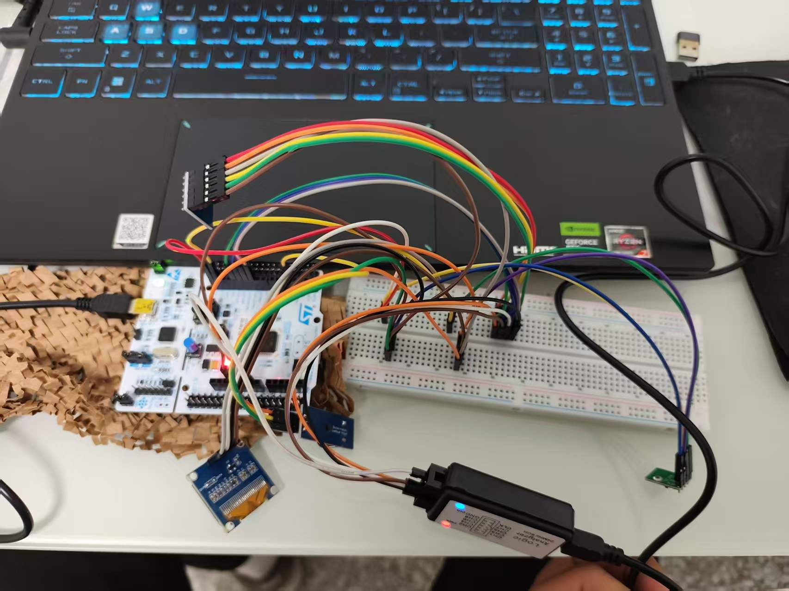
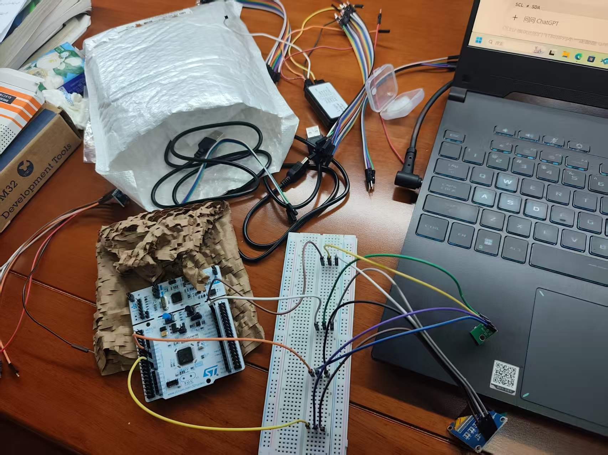
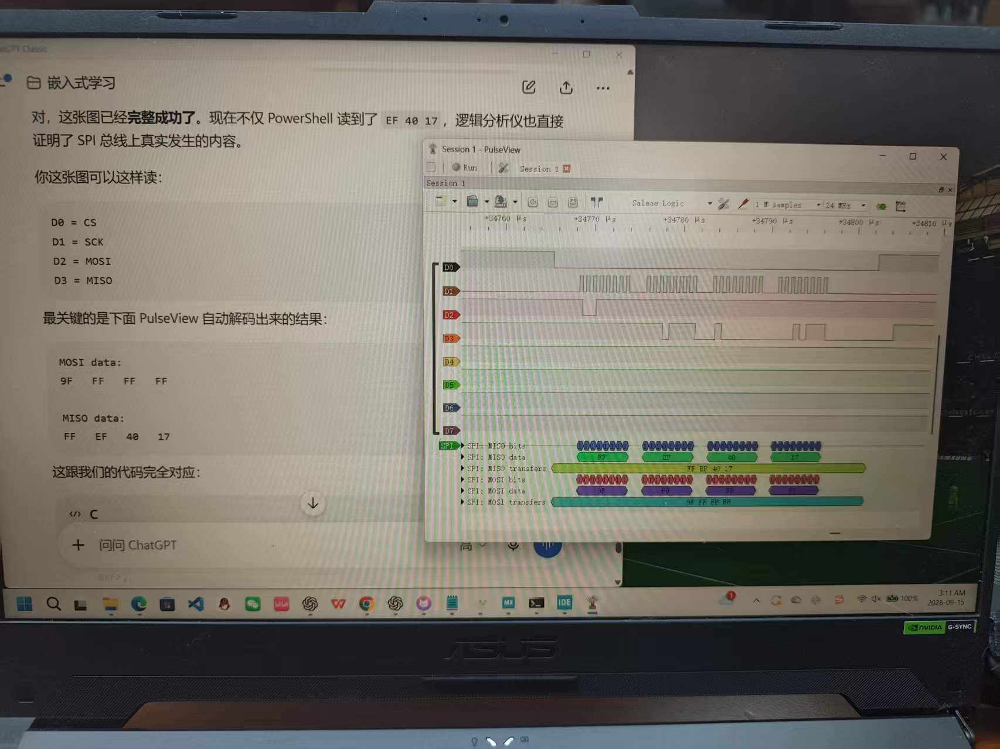
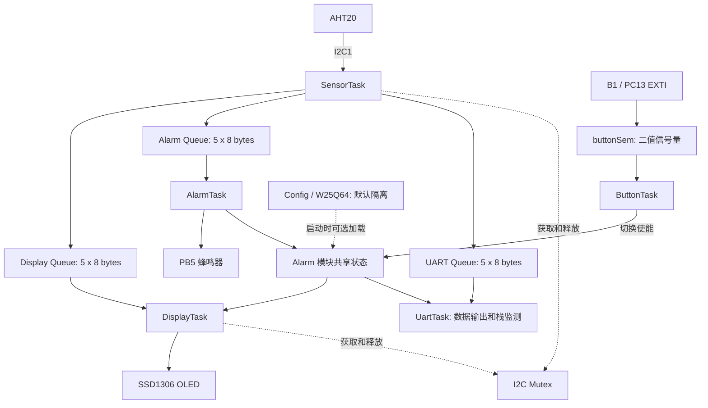

# STM32 + FreeRTOS 多任务环境监测与报警终端

基于 **NUCLEO-F401RE / STM32F401RE / Cortex-M4** 的个人嵌入式项目，从裸机外设开发演进为五任务架构，实践温湿度采集、OLED 显示、串口观测、滞回报警与按键控制。

`C` · `STM32 HAL` · `STM32CubeIDE` · `CubeMX` · `FreeRTOS` · `CMSIS-RTOS2` · `I2C` · `SPI` · `UART` · `EXTI`

**当前版本：** 已同步本地五任务源码与诊断程序。默认使用 RAM 报警阈值，外部 Flash 配置路径隔离；W25Q64 驱动已实现，擦写与断电可靠性仍待验证。Event Flags 未用于主项目业务同步。

## 实物与调试展示



本次补充的实际联调照片：开发板、面包板、外接模块及 USB 逻辑分析仪。屏幕未展示可读温湿度结果，照片用于说明搭建和测量环境。

<details>
<summary>早期接线与 SPI 解码实拍</summary>




可见一次 `9F` 命令及 `EF 40 17` ID 响应。单次成功读取不代替擦写和稳定性测试。

</details>

## 系统架构



采集任务将同一份 8 字节数据复制到三路独立队列，每路容量 5；消费者各自阻塞等待。I2C Mutex 保护传感器与 OLED 访问，EXTI 通过二值信号量唤醒 ButtonTask。AlarmTask 为 AboveNormal，其余为 Normal；每任务配置 1024 字节栈。

## 核心实现

- **采集与显示：** AHT20 数据解析、×10 整数传递、SSD1306 显示及 UART 输出。
- **滞回报警：** 任一值达到触发阈值时报警，两个值均降至恢复阈值时恢复；B1 切换蜂鸣器使能。
- **任务解耦：** 非阻塞三路投递、各路失败计数；显示变慢不会直接阻塞其他消费者。
- **运行观测：** UART 数据日志、五任务栈空间高水位监测、QueueDropCount；队列压力模式另有阶段统计。
- **Flash 驱动：** JEDEC ID、三组状态寄存器、WEL 检查、擦除、页编程、读取和 BUSY 超时；保留只读诊断与同步采集模式。
- **模块化：** 器件驱动、配置管理、报警业务独立封装，保留原 CubeIDE 路径。

[总体架构](docs/architecture.md) · [FreeRTOS 设计](docs/freertos-design.md) · [通信与引脚](docs/communication-protocols.md) · [测试记录与计划](docs/testing-record.md) · [Flash 调试档案](docs/flash-diagnostics.md)

## 编译与使用

1. 克隆本仓库，使用 STM32CubeIDE 2.2.0，在新工作空间选择 **File → Import → General → Existing Projects into Workspace**，导入根目录。
2. 工程名保持 `gpio_led01`，选择 Debug，执行 Build Project。`Middlewares` 包含 FreeRTOS 与 CMSIS-RTOS2 适配层。
3. 按 [引脚表](docs/communication-protocols.md) 接线，经 ST-LINK 烧录。串口选择板载虚拟串口，115200 / 8N1。
4. 启动顺序为 HAL/时钟/外设及器件初始化、配置默认值、内核初始化、创建同步对象与五任务、句柄检查、`osKernelStart`。
5. 默认应输出 RAM 配置来源及 `APP_RTOS_READY tasks=5 queues=3`，随后在采集成功时输出温湿度。此处描述代码预期，不作为本次真机运行日志。

| 编译宏 | 默认 | 用途 |
| --- | --- | --- |
| APP_USE_FLASH_CONFIG | 0 | 隔离 Flash，使用 RAM 默认阈值 |
| QUEUE_STRESS_TEST | 0 | 三路队列消费者降速、统计与恢复检查 |
| FLASH_READ_DIAG_MODE | 0 | 调度前进入独立只读诊断 |
| FLASH_SPI_CAPTURE_MODE | 0 | 只读诊断中等待 UART 的 R 命令并批量采集 |

前三个可通过编译器预定义宏选择；不要把压力测试与 Flash 模式混用。写测试宏保留在源码并关闭。可靠性验证完成前保持默认隔离配置。

## 验证状态与后续工作

2026-11-22 已进行发布副本的实际构建，详情和证据见 [构建记录](docs/build-record.md)。历史实拍、作者报告、源码实现、构建结果及待执行真机测试分别记录，不把构建成功表述为硬件验收通过。

优先补充：报警并发访问验证、OLED 负温度格式、I2C 超时与恢复、任务栈/堆监测、Flash 可靠性和 8 小时稳定性实验。队列压力模式保留真实消费者，其 Drain 阶段仍有生产者投递，相关限制见 RTOS 文档。

## 仓库结构

```text
Core/                 应用、器件驱动、RTOS 配置和启动代码
Application/          报警模块
Drivers/              CMSIS / STM32 HAL
Middlewares/          FreeRTOS 和 CMSIS-RTOS2
Images/               三张真实接线与 SPI 调试照片
docs/                 架构、通信、测试、Flash 和构建记录
.project / .cproject   CubeIDE 工程
gpio_led01.ioc        CubeMX 配置
STM32F401RETX_*.ld     链接脚本
```

这段演进实践覆盖了从外设通信、模块接口到多任务通信、共享资源保护及故障定位的完整开发过程。实现细节、设计取舍与未验证项均保留，便于复现与面试交流。
