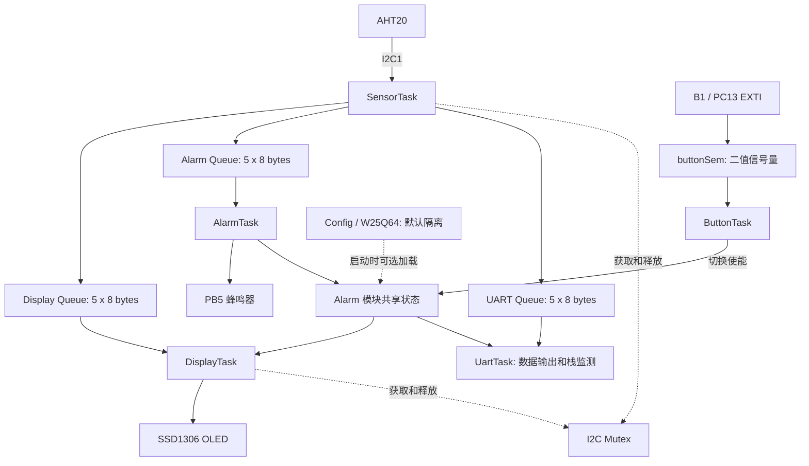

# 系统架构

平台为 NUCLEO-F401RE（Cortex-M4），系统时钟 84 MHz。硬件接线见 [通信与引脚](communication-protocols.md)。从裸机主循环演进为 CMSIS-RTOS2 五任务；当前任务入口和对象创建位于 `Core/Src/main.c`，`freertos.c` 保留生成器框架。

## 职责与依赖

| 层次 | 模块 | 职责 |
| --- | --- | --- |
| 任务调度 | main.c | 初始化、创建 RTOS 对象、采集与三路数据分发、按键处理、监测 |
| 业务 | Application/alarm.c | OR 触发、AND 恢复、报警使能、蜂鸣器输出 |
| 配置 | Core/Src/config.c | 默认阈值、关系和范围检查、Flash 地址及存储布局 |
| 器件驱动 | aht20.c / oled.c / w25q64.c | HAL 总线调用、命令与数据解析、错误返回 |
| 平台 | HAL / CMSIS / FreeRTOS | 外设、内核与 Cortex-M4F 端口 |

传感器成功读数转换为两个 32 位的 ×10 整数，按值复制到三条队列。三个消费者分别接收自己的数据；单队列的多个读者会分走消息，不能实现三路广播。显示与 UART 另行读取报警模块状态，因此压力条件下不能保证状态与某一帧传感器数据严格对应。

I2C1 由传感器与 OLED 共用，任务使用同一个 Mutex。Flash 默认不进入正常业务路径；启用时在调度启动前初始化和读取配置。ButtonTask 和 AlarmTask 都可更新蜂鸣器，报警模块的共享访问尚未集中为单一任务所有权，属于后续并发验证重点。

保留现有 CubeIDE 文件布局，未把自定义驱动搬到 HAL 的 Drivers 目录。ADC1、TIM2 等初始化保留，但不把它们列为五任务环境监测的新增业务功能。
